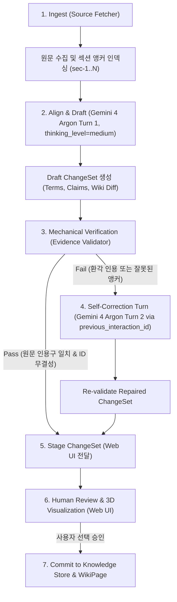

# Project IDEA Product Requirements Document

## 문서 정보

| 항목 | 내용 |
|------|------|
| PRD 제목 | Project IDEA (AI Knowledge Assimilation Web Service) |
| 버전 | 0.3 (Web-Only Focus & Problem-Centric) |
| 트랙 | Track 4. Open Innovation (Autonomous Agents and Developer Tools) |
| 개발 시간 | 단일 스프린트 (마감: 15:20 KST) |
| 배포 환경 | Google Cloud Run (단일 컨테이너: FastAPI + Three.js Web UI) |
| PRD 상태 | Ready for Issue Triage & Sprint Kickoff |

## 1. One Pager

### 1.1 Overview

Project IDEA는 신규 기술 자료(논문, 테크 블로그, 릴리스 노트)를 읽고 기존 사용자의 도메인 지식 체계에 안전하게 편입시키는 **지식 편입 에이전트(Knowledge Assimilation Agent) 기반 웹 서비스**다.

사용자가 웹 브라우저에서 공개 URL과 분석 질문을 입력하면, `gemini-4-argon`이 원문을 수집·분석하고 기존 도메인 용어 및 Wiki와 대조하여 근거가 연결된 변경안(`ChangeSet`)을 생성한다. 기계적 인용 검증기(`Evidence Validator`)와 `gemini-4-argon`의 자가 교정 루프(`previous_interaction_id`)를 통과한 항목만 제시되며, 사용자는 4개 계층의 3D 공간과 Knowledge Diff 패널에서 승인 여부를 결정한다. 승인된 지식만 영속 Wiki와 지식 그래프에 반영된다.

**Tagline.** Don't just collect information. Watch your knowledge take shape.

### 1.2 Problem (우리가 푸는 진짜 문제)

LLM을 이용해 문서를 요약하거나 노트를 자동 생성하는 도구는 많다. 하지만 **새로운 정보를 기존 지식 체계에 편입(Assimilation)할 때 발생하는 3가지 치명적인 지식 오염 문제**는 기존 도구들이 해결하지 못한다.

1. **개념 파편화 및 중복 (Concept Fragmentation & Synonym Blindness).**
   - 논문마다 같은 개념을 다른 표현으로 쓴다. (예: `PagedAttention` vs "block-level virtual memory paging").
   - 기존 요약 도구는 이를 별개의 새 개념으로 등록해 지식 베이스를 파편화하거나, 반대로 이름만 유사하고 본질이 다른 개념을 하나로 잘못 병합한다.
2. **환각 인용으로 인한 근거 붕괴 (Hallucinated Citations & Fabricated Quotes).**
   - LLM은 원문에 없는 수치나 요약문을 마치 실제 원문의 발췌문인 것처럼 그럴듯하게 인용한다.
   - 연구자나 엔지니어는 인용된 문장이 실제 원문 몇 번 섹션에 존재하는지 일일이 다시 찾아보며 지친다.
3. **기존 지식과의 무인 충돌 및 덮어쓰기 (Silent Overwrite of Contradicting Facts).**
   - 새로운 문서의 주장이 기존 팀 Wiki나 지식 베이스의 사실(예: 특정 분산 서빙 프레임워크의 지원 여부, 벤치마크 조건)과 정면으로 배치될 때, 기존 에이전트는 아무 경고 없이 기존 문서를 덮어쓰거나 무비판적으로 병합해 RAG 컨텍스트를 망친다.
4. **블랙박스 요약의 피로감 (Lack of Provenance & Human Control).**
   - AI가 생성한 지식이 원천 자료의 어디서 출발해 어떤 추론 과정을 거쳐 Wiki의 한 줄이 되었는지 역추적할 수 없어, 결국 사람이 AI의 출력을 신뢰하지 못하고 다시 처음부터 문서를 읽게 된다.

### 1.3 Target Persona & Core User Pain

- **Persona: AI Systems Engineer & Researcher (LLM Serving Domain).**
  - 최신 논문(vLLM, SGLang, DistServe 등)을 읽고 팀의 시스템 지식 Wiki를 지속해서 갱신하는 엔지니어.
  - **Core Pain:** "새 논문이 나올 때마다 우리 기존 서빙 용어와 어떻게 매핑되는지, 원문에 실제 적힌 근거가 맞는지, 기존 아키텍처 문서와 상충하는 점은 없는지 일일이 수동 대조하느라 하루 반나절을 쓴다."

### 1.4 Objectives

1. **근거 보증형 지식 편입 루프 (Zero-Hallucination Citations).**
   - 기계적 검증기(`Evidence Validator`)를 통해 원문에 실제 존재하는 문장만 인용으로 통과시키며, 환각 인용 발생 시 `gemini-4-argon`의 `previous_interaction_id`로 자가 교정하여 인용 오염률 0%를 달성한다.
2. **명확한 도메인 정렬 (Domain Semantic Triaging).**
   - 새로운 용어를 `MATCH`(동의어 매핑 및 기존 문서 갱신), `PROPOSE`(새로운 독립 개념 제안), `UNRESOLVED`(기존 지식과 충돌 또는 모호성)로 엄격히 분류한다.
3. **인간 개입 통제 (Human-in-the-Loop Gate).**
   - 충돌(`UNRESOLVED`)이나 미검증 주장은 절대 자동 반영하지 않는다. 사용자가 변경안(Knowledge Diff)에서 시각적으로 확인하고 승인한 항목만 Wiki에 커밋한다.
4. **4단계 3D 공간을 통한 투명한 지식 시각화 (Interactive 3D Knowledge Universe).**
   - 원천 자료(Source) -> 의미 정렬(Domain) -> 지식 그래프(Graph) -> 최종 문서(Wiki)의 흐름을 3D 원반 계층으로 시각화하고, 클릭 한 번으로 Wiki 문장에서 원문 인용구까지 역방향 추적(Provenance Tracing)을 제공한다.
5. **3분 이내 라이브 데모 및 단일 Cloud Run 웹 서비스 완성.**
   - 복잡한 다중 컴포넌트(MCP 등)를 배제하고, 단일 컨테이너(FastAPI + Three.js)로 45초 이내에 지식 편입 루프를 완료하는 웹 서비스를 Google Cloud Run에 배포한다.

### 1.5 Constraints

1. **시간:** 15:20 KST 심사 시작 전까지 작동하는 Cloud Run 웹 서비스 배포 및 3분 이내 라이브 데모 영상 완성.
2. **기술 스택 단순화:** 별도의 복잡한 외부 DB나 MCP 없이, Python(FastAPI) + Google GenAI SDK(`gemini-4-argon`) + Three.js(정적 서빙) 단일 패키지로 구성.
3. **API 규칙 준수:** `google-genai >= 2.3.0`, Interactions API(`client.interactions.create`), `model="gemini-4-argon"`, `thinking_level="medium"`, Pydantic Structured Output.

### 1.6 Use Cases (Core Scenarios)

#### Scenario 1. 동의어 식별 및 기존 Wiki 확장 (`MATCH`)
사용자가 vLLM 관련 기술 문서를 입력한다. 에이전트는 문서의 "block-level KV memory allocation"이 기존 레지스트리의 `PagedAttention`과 동일함을 식별(`MATCH`)하고, 중복 개념을 만들지 않고 기존 `PagedAttention` Wiki의 인용 근거와 설명 문장을 갱신하는 변경안을 제안한다.

#### Scenario 2. 환각 인용 검출 및 자가 교정 (`SELF_CORRECTED`)
1차 생성에서 원문 수치와 다른 문장을 인용한 경우, 기계적 검증기가 즉시 실패 판정을 내린다. `gemini-4-argon`이 이전 인터랙션 컨텍스트(`previous_interaction_id`)를 활용해 원문 섹션을 재대조하고 올바른 원문 인용구로 스스로 교정한다.

#### Scenario 3. 기존 지식과의 모순 발견 및 인간 승인 게이트 (`UNRESOLVED`)
신규 문서가 기존 Wiki에 정의된 가설이나 성능 수치와 정면 충돌할 때, 에이전트는 이를 멋대로 덮어쓰지 않고 `UNRESOLVED` 상태로 표시한다. 3D 뷰에서 경고 노드로 표시되며 사용자가 직접 확인하고 수동 결정한다.

## 2. Technical Architecture & Agent Loop

### 2.1 단일 웹 서비스 구조

- **Backend:** FastAPI (Python 3.11).
  - `/api/assimilate`: 원문 URL 입력 및 2단계 검증 루프 실행.
  - `/api/state`: 현재 용어 레지스트리, 지식 그래프, WikiPage 상태 조회.
  - `/api/changesets/{id}/commit`: 사용자가 선택 승인한 변경안 반영.
  - `/api/reset`: 시연용 초기 시드 상태로 원클릭 리셋.
- **Frontend:** HTML5 + Vanilla JS (ES Modules) + Three.js.
  - FastAPI가 `static/` 경로에서 직접 단일 페이지 애플리케이션(SPA) 서빙 (CORS, 빌드 도구 설정 시간 0분 소요).
  - 4개 회전 계층 시각화:
    - Layer 1 (상단): Source Document & Anchored Sections.
    - Layer 2: Domain Semantic Layer (Terms & Status: MATCH/PROPOSE/UNRESOLVED).
    - Layer 3: Knowledge Graph (Concepts & Claims).
    - Layer 4 (하단): Living Wiki Pages.
  - 우측 패널: Knowledge Diff & 검증 상태 배지, 승인 체크박스, Commit 버튼.

## 3. Scope & Execution Plan (Issue Triage)

| Issue ID | 작업 내용 | 검증 기준 (Definition of Done) |
|----------|-----------|--------------------------------|
| **Issue #1** | 데이터 모델(`models.py`), 시드 지식(`seed_domain.json`), 기계적 검증기(`validator.py`) | 인용구 정규화 매칭, ID 무결성 검증 단위 테스트 100% 통과 |
| **Issue #2** | `gemini-4-argon` 연동 수집·정렬 루프 및 자가 교정기(`agent_loop.py`, `eval_harness.py`) | 4대 핵심 시나리오(동의어, 신규 개념, 환각 인용 교정, 모순 보류) CLI 테스트 통과 |
| **Issue #3** | FastAPI 웹 API 구축(`server.py`, `store.py`) | `/api/assimilate`, `/api/state`, `/api/commit` 엔드포인트 동작 확인 |
| **Issue #4** | Three.js 3D 지식 공간 및 Knowledge Diff 웹 UI(`static/`) | 4개 계층 회전, 상태별 노드 색상, Diff 승인 및 역방향 인용 추적 브라우저 구동 확인 |
| **Issue #5** | Cloud Run 배포, 영문 README, 3분 시연 영상 녹화 준비 | Cloud Run 배포 URL 헬스체크 정상, 라이브 시연 리허설 완료 |

## 4. Success Metrics

1. **환각 인용 유출률:** 0% (기계적 검증기를 거치지 않은 인용은 단 하나도 Wiki에 커밋되지 않음).
2. **지식 편입 처리 시간:** 45초 이내 (3분 라이브 심사 시간 내 여유 있는 시연 가능).
3. **핵심 4대 평가 케이스 통과율:** 100% (`scripts/eval_harness.py` 기준).
4. **배포 완성도:** Google Cloud Run 공개 URL에서 누구나 즉시 브라우저로 접속해 체험 가능.
