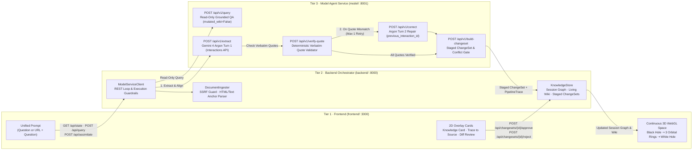

<div align="center">

# 🌌 Project IDEA

### **Autonomous Knowledge Assimilation & Epistemic Verification Engine**
*Ask your knowledge, ingest primary sources, inspect grounded diffs, and reuse approved insights in a continuous 3D semantic space.*

[](https://project-idea-529324293576.asia-northeast3.run.app)
[](https://ai.google.dev)
[](https://ai.google.dev/gemini-api/docs/interactions-overview)
[](https://fastapi.tiangolo.com)

[](pyproject.toml)
[](https://docs.astral.sh/uv/)
[](pyproject.toml)
[](scripts/lint_no_comments.py)
[](LICENSE)

[**Live Web App**](https://project-idea-529324293576.asia-northeast3.run.app) · [**Product Requirements (`PRD.md`)**](PRD.md) · [**Spatial UI Spec (`DESIGN.md`)**](DESIGN.md) · [**Agent Governance (`AGENTS.md`)**](AGENTS.md) · [**Demo Script (`DEMO_SCRIPT.md`)**](DEMO_SCRIPT.md)

</div>

---

## ⚡ Overview

**Project IDEA** is an agentic personal knowledge library built for researchers and engineers reading dense technical literature (focused on **LLM Inference & Serving**). Instead of dumping unverified summaries into a static note vault, Project IDEA connects new primary sources to your existing canonical knowledge, enforces **deterministic mechanical quote verification**, surfaces **semantic conflicts**, and stages **human-in-the-loop Knowledge Diffs (`ChangeSet`)** before updating your session's Living Wiki.

Everything happens inside a single continuous WebGL scene driven by one unified prompt:
- **Left Portal (`Black Hole`, $X = -22$)**: Primary source ingestion anchor where raw URLs and technical documents enter after passing SSRF and content-type guardrails.
- **Center Space (`3-Ring Rotating Semantic Orbits`, $X = -12 \dots +12$)**: Multi-ring 3D orbital layers (`Domain Terms`, `Canonical Concepts`, `Grounded Claims`) aligning `TERM`, `CONCEPT`, `ENTITY`, and `CLAIM` nodes against existing session knowledge.
- **Right Portal (`White Hole`, $X = +22$)**: Output portal where human-approved `ChangeSet` mutations emerge into the active **Living Wiki** for immediate reuse in follow-up session queries.

---

## 🎯 Why Naive RAG & Auto-Wiki Tools Fail

| Failure Mode in Naive Tools | How Project IDEA Solves It |
| :--- | :--- |
| **1. Concept Fragmentation (Synonym Blindness)**<br/>Reading *"tree search heuristics"* or *"vLLM block-paged KV management"* spawns duplicate nodes instead of linking to canonical concepts. | **Canonical Semantic Alignment (`MATCH` / `PROPOSE` / `UNRESOLVED`)**<br/>Gemini 4 Argon aligns incoming terms against canonical domain concepts (`concept_mcts`, `concept_paged_attention`, `concept_kv_cache`) with explicit alignment rationale. |
| **2. Hallucinated Citations & Fabricated Quotes**<br/>LLMs paraphrase or invent quotes that do not exist in the primary source text. | **Deterministic Mechanical Evidence Validator + Turn-2 Repair**<br/>Every claim requires a verbatim `exact_quote` checked via normalized substring matching. If validation fails, Argon receives the exact mechanical failure via `previous_interaction_id` and self-corrects in Turn 2. |
| **3. Silent Overwrite of Contradictions**<br/>New papers silently overwrite established wiki claims without surfacing experimental scope or conflicts. | **Epistemic Separation & Staged Human Approval**<br/>Mechanical quote matching, Argon semantic review, and user approval are strictly separated. Conflicting claims are held as `UNRESOLVED`, and only user-approved items enter the session Wiki. |

---

## 🏗️ System Architecture (3-Tier REST + Stateful Interactions Loop)

Project IDEA enforces strict separation of concerns across three decoupled runtime boundaries (`frontend/`, `backend/`, `model/`):



### Runtime & Subagent Thinking Effort Governance (`AGENTS.md`)

| Scope / Stage | Responsibility | Component / Model | `thinking_level` | Verification Gate |
| :--- | :--- | :--- | :---: | :--- |
| **Runtime (Stage 1)** | Source Ingestion, Section Anchor Parsing & Jargon (`TERM`) Candidate Identification | `backend/ingest.py` + `gemini-4-argon` | Deterministic + `medium` | SSRF/private-IP & binary payload blocking (`2 MB` cap), section anchor extraction, domain acronym/jargon separation |
| **Runtime (Stage 2)** | Canonical Concept (`CONCEPT` / `ENTITY`) Alignment & Relation Extraction | `gemini-4-argon` | `medium` | Classifies candidates against seed/session Wiki as `MATCH` (synonym merge), `PROPOSE` (novel concept), or `UNRESOLVED` (ambiguous/conflicting) |
| **Runtime (Stage 3)** | Claim Evidence Extraction, Mechanical Quote Verification & Turn-2 Self-Correction | `EvidenceValidator` + `gemini-4-argon` (`previous_interaction_id`) | `medium` (Turn 1) $\rightarrow$ `high`/`medium` (Turn 2) | Verbatim normalized substring & referential integrity check; max 1 stateful repair turn before isolating failures as `Blocked` (`REJECTED`) |
| **Runtime (Stage 4–5)** | Selective Human Approval (`White Hole`) & Same-Session Grounded Query (`Query`) | `backend/store.py` + `gemini-4-argon` | `medium` | Server-side quote re-verification on approval, dangling-reference prevention, idempotent state transitions, and grounded follow-up `Query` citations |
| **Dev Subagents (`[T1-A]`)** | WebGL 3D Orbital Physics & Raycast Rendering | `gemini-3.8-flash` (`flash`) | `low` / `medium` | Left Black Hole $\rightarrow$ Center 3-ring rotating orbits (`TERM`/`CONCEPT`/`CLAIM`) $\rightarrow$ Right White Hole & hit-testing |
| **Dev Subagents (`[T1-B]–[T3]`)** | Frontend UI, Backend Guardrails & Model Loop Implementation | `gemini-4-argon` (`pro` / `inherit`) | `high` | Shared contract compliance, mechanical vs. semantic separation, stage-by-stage pipeline implementation |
| **Dev Subagents (`[T4]–[T5]`)** | E2E Golden Path Integration & Independent Browser/Deployment Audit | `gemini-4-argon` (`Argon Mid`) | `medium` | Independent verification of `AC-01`–`AC-10`, non-occluding 3D layout, and live Cloud Run audit |

---

## 🎨 Spatial Interface & Epistemic Design (`DESIGN.md`)

Project IDEA pairs a high-craft light-mode scientific workspace (`#F7F9FC` canvas with Google-inspired `#4285F4` Blue, `#EA4335` Red, `#FBBC05` Yellow, `#34A853` Green accents) with a continuous left-to-right 3D WebGL scene (`IdeaSceneManager`):

```text
IDEA                                               Session only · execution status

[ BLACK HOLE ]  ⇢  [ Terms / Knowledge Orbits + Existing Nodes ]  ⇢  [ WHITE HOLE ]
  Source URL            candidates · evidence · relations             Wiki changes
  (X = -22)           3 Tilted Rings (X = -12 to +12)                  (X = +22)

                     [ Answer / Selected Node / Review Card ]

                 [ One prompt: question or URL + question        → ]
```

### Epistemic Verification Badges (Zero Conflation)

Project IDEA never collapses source existence, model opinion, objective truth, and human approval into a single generic "Verified" badge:

| Verification Badge | Layer / Meaning | What It Guarantees (and Does Not Claim) |
| :--- | :--- | :--- |
| `Seed knowledge` | Initial Session Baseline | Pre-loaded canonical LLM Inference & Serving concepts/claims marked as session examples. |
| `Source located` | Mechanical Ingestion | Public URL resolved (SSRF-checked) and readable text/section anchor extracted by `DocumentIngester`. |
| `Quote matched` | Mechanical Verification | Exact quote deterministically verified in raw source text (`mechanical_verified = True`). Does *not* prove universal truth of the claim. |
| `Model-reviewed` | Argon Semantic Alignment | Aligned by Gemini 4 Argon (`MATCH` / `PROPOSE`) with conditions and scope preserved. |
| `Needs review` | Conflict / Ambiguity Gate | Contradicts existing claims or lacks sufficient context (`UNRESOLVED`); held back from auto-apply. |
| `Blocked` | Mechanical Gate Failure | Failed verbatim quote check or broken referential integrity even after Turn-2 repair; cannot be approved. |
| `Added to this session` | Human-in-the-Loop Gate | Explicitly approved by the user in the current session and active for subsequent queries. |

### 9-Stage Execution State Machine

| State | Visual & Interactive Behavior |
| :--- | :--- |
| `Idle / Explore` | Displays seed/session knowledge, slow independent ring rotation, both portals, and the bottom prompt. |
| `Query` | Highlights referenced knowledge paths and opens the grounded Answer Card without mutating the graph. |
| `Ingest` | Anchors the incoming URL/source at the left Black Hole portal; surfaces fetch/SSRF/binary errors honestly. |
| `Align` | Highlights matched canonical nodes (`MATCH`) and renders candidate proposals (`PROPOSE`) with dashed links. |
| `Verify / Repair` | Displays real-time mechanical quote check status and Turn-2 Argon self-correction (`previous_interaction_id`). |
| `Review` | Pauses orbit rotation for readable side-by-side Source vs. Proposed Diff inspection without occluding the White Hole. |
| `Apply` | Commits user-selected valid changes while preventing duplicate submission clicks. |
| `Complete` | Emerges approved Wiki updates through the right White Hole portal and enables follow-up session queries. |
| `Unresolved / Error` | Preserves existing session knowledge untouched and explains exact mechanical, network, or conflict reasons. |

---

## 🧠 Canonical Seed Domain (LLM Inference & Serving)

Out of the box, `seed_domain.json` initializes a curated ontology and grounded claims covering modern LLM serving and reasoning systems:

| Canonical ID | Name | Node Type | Known Aliases / Synonyms |
| :--- | :--- | :---: | :--- |
| `concept_kv_cache` | **KV Cache** | `TERM` | `key-value cache`, `attention KV cache`, `autoregressive KV state` |
| `concept_paged_attention` | **PagedAttention** | `CONCEPT` | `paged attention`, `vLLM block-paged KV management`, `virtual memory KV paging` |
| `concept_speculative_decoding` | **Speculative Decoding** | `CONCEPT` | `speculative sampling`, `draft-and-verify decoding`, `assisted generation` |
| `concept_mcts` | **Monte Carlo Tree Search** | `TERM` | `MCTS`, `tree search heuristic`, `rollout search` |
| `concept_tot` | **Tree of Thoughts** | `CONCEPT` | `ToT`, `tree-of-thought prompting`, `branching reasoning` |
| `concept_rlhf` | **Reinforcement Learning from Human Feedback** | `TERM` | `RLHF`, `human feedback alignment`, `preference tuning` |
| `concept_agentic_loop` | **Autonomous Agent Loop** | `CONCEPT` | `agent loop`, `ReAct loop`, `autonomous loop` |
| `concept_interactions_api` | **Interactions API** | `ENTITY` | `client.interactions.create`, `Gemini Interactions API`, `Argon Interactions API` |

---

## 📂 Repository Structure & Ownership Boundaries

```text
project-idea/
├── frontend/                     # Tier 1: WebGL Spatial UI & Diff Inspector (:3000)
│   ├── index.html                # Single-screen spatial canvas, collapsible overlay cards & unified prompt
│   ├── scene_physics.js          # Three.js Left-to-Right portals, 3-ring orbital physics & raycast engine
│   ├── app.js                    # Stateful session client, trace highlighting & ChangeSet review controller
│   └── server.py                 # Standalone FastAPI frontend server injecting window.BACKEND_API_URL
├── backend/                      # Tier 2: Ingestion, KnowledgeStore & Guardrails (:8000)
│   ├── schemas.py                # Shared Pydantic v2 contracts (Concept, FactClaim, ChangeSet, QueryResponse)
│   ├── store.py                  # Session Knowledge Graph, Living Wiki & ChangeSet state manager
│   ├── ingest.py                 # SSRF-safe public URL fetcher, binary guard & section anchor extractor
│   ├── model_client.py           # Async httpx client orchestrating the multi-turn Model Tier REST loop
│   ├── server.py                 # Backend FastAPI routes (/api/state, /api/assimilate, /api/changesets/*)
│   └── seed_domain.json          # Canonical LLM Inference & Reasoning seed ontology
├── model/                        # Tier 3: Gemini 4 Argon Agent & Mechanical Validator (:8001)
│   ├── schemas.py                # Extraction, verification & multi-turn self-correction schemas
│   ├── validator.py              # Deterministic verbatim quote & referential integrity validator
│   ├── agent_loop.py             # AssimilationEngine (Gemini 4 Argon Interactions API Turn 1 & Turn 2)
│   └── server.py                 # Model Tier FastAPI service (/api/v1/extract, /verify-quote, /correct)
├── scripts/
│   ├── eval_harness.py           # 3-scenario live Gemini 4 Argon evaluation benchmark
│   ├── verify_argon.py           # Interactions API connectivity & thinking summary smoke test
│   └── lint_no_comments.py       # AST & tokenizer linter enforcing zero comments/docstrings across Py/JS/HTML
├── tests/
│   ├── test_3tier_rest_loop.py   # End-to-end 3-Tier multi-turn self-correction integration test
│   ├── test_server.py            # Backend API state & approval lifecycle tests
│   └── test_validator.py         # Deterministic quote & referential integrity unit tests
├── .pre-commit-config.yaml       # Local pre-commit hooks (lint_no_comments.py + ruff check)
├── PRD.md                        # Product Requirements Document (v0.7 — Product outcomes first)
├── DESIGN.md                     # Spatial UI, color tokens, typography & interaction specification
├── AGENTS.md                     # Multi-agent engineering rules, model governance & verification loop
├── LINEAR_TRIAGE.md              # Parallel execution & verification plan (T0–T5)
├── Dockerfile                    # Multi-service production container for Google Cloud Run
├── start_3tier.sh                # Launches Model (:8001), Backend (:8000), and Frontend (:3000) locally
└── deploy.sh                     # Automated Cloud Build & Cloud Run deployment script
```

---

## 🔌 REST API Contract Across All 3 Tiers

| Tier | Method & Endpoint | Description |
| :--- | :--- | :--- |
| **Frontend (`:3000`)** | `GET /` · `GET /static/*` | Serves the 3D WebGL Semantic Library SPA (`index.html`, `scene_physics.js`, `app.js`) and injects `BACKEND_API_URL`. |
| **Frontend (`:3000`)** | `GET /health` | Health probe returning frontend tier status and bound backend URL. |
| **Backend (`:8000`)** | `GET /api/state` | Returns active session `concepts`, `relations`, approved `claims`, and pending `changesets`. |
| **Backend (`:8000`)** | `POST /api/query` | Executes a read-only grounded query (`QueryRequest` $\rightarrow$ `QueryResponse`) against approved session knowledge (`mutated_wiki = False`). |
| **Backend (`:8000`)** | `POST /api/assimilate` | Ingests a public URL or raw text snippet (`prepare_document`) and orchestrates the 2-turn Model Tier assimilation loop. |
| **Backend (`:8000`)** | `POST /api/changesets/{id}/approve` | Selectively commits verified proposals (`concept_ids`, `relation_ids`, `claim_ids`) with referential integrity checks into the Living Wiki. |
| **Backend (`:8000`)** | `POST /api/changesets/{id}/reject` | Rejects a pending `ChangeSet` while preserving existing session knowledge unchanged. |
| **Backend (`:8000`)** | `POST /api/reset` | Resets the active session store back to the canonical `seed_domain.json` baseline. |
| **Model (`:8001`)** | `POST /api/v1/query` | Runs Gemini 4 Argon grounded QA (`AssimilationEngine.answer_query`) returning node citations and thought summaries. |
| **Model (`:8001`)** | `POST /api/v1/verify-quote` | Deterministically verifies verbatim substring existence (`EvidenceValidator.verify_quote`). |
| **Model (`:8001`)** | `POST /api/v1/extract` | Runs Turn-1 Gemini 4 Argon extraction (`client.interactions.create`) + initial quote check. |
| **Model (`:8001`)** | `POST /api/v1/correct` | Runs Turn-2 stateful self-correction via `previous_interaction_id` on failed quotes. |
| **Model (`:8001`)** | `POST /api/v1/build-changeset` | Packages validated concepts, relations, claims, and unresolved conflicts into a `ChangeSet`. |
| **Model (`:8001`)** | `POST /api/v1/assimilate` | Executes the complete Turn-1 $\rightarrow$ Validator $\rightarrow$ Turn-2 pipeline with `PipelineTrace`. |

---

## ✅ Verification Loop & Benchmark Suite

### Automated Evaluation Scenarios (`scripts/eval_harness.py`)

| Scenario | Capability Verified | Expected Outcome | Status |
| :--- | :--- | :--- | :---: |
| **1. Synonym Alignment** | Canonical Concept Resolution | Maps *"tree search heuristic"* to `concept_mcts` (`MATCH`) instead of duplicating nodes | ✅ **PASS** |
| **2. Mechanical Quote Grounding** | Verbatim Substring + Turn-2 Repair | Rejects non-verbatim quotes; Argon repairs quote via `previous_interaction_id` | ✅ **PASS** |
| **3. Contradiction Gate** | Silent Overwrite Prevention | Conflicting claims are flagged `UNRESOLVED` and held back from automatic Wiki mutation | ✅ **PASS** |

### Product Acceptance Criteria (`PRD.md` AC-01 – AC-10)

- **AC-01 (Zero-Auth Entry)**: Immediate access to the unified prompt and continuous Left-Center-Right 3D space on public URL.
- **AC-02 (Read-Only Query)**: Answers questions with grounded node citations without mutating approved session knowledge.
- **AC-03 (Source Assimilation)**: Reads public URLs, answers user questions, and stages a comparative `ChangeSet` against existing knowledge.
- **AC-04 (Synonym vs. Novel Concept)**: Links aliases (`MATCH`) to canonical concepts while separating new concepts (`PROPOSE`) or holding ambiguous ones (`UNRESOLVED`).
- **AC-05 (Mechanical & Semantic Guardrails)**: Blocks fabricated quotes (`Blocked`) and prevents unresolved contradictions from overwriting existing claims.
- **AC-06 (Selective Approval & Idempotency)**: Applies only approved valid changes; rejection and duplicate clicks never corrupt session state.
- **AC-07 (Interactive Node Inspection)**: Clicking nodes opens `Knowledge Card` with `Trace to source` without permanently occluding the right White Hole.
- **AC-08 (Same-Session Reuse)**: Newly approved knowledge is immediately cited in subsequent session questions; unapproved drafts are never cited as fact.
- **AC-09 (Honest Failure Handling)**: Surfaces network, SSRF/binary, parsing, or model errors transparently while preserving existing session knowledge.
- **AC-10 (Live Cloud Execution)**: Runs real Gemini 4 Argon + mechanical validation on Google Cloud Run with server-side API key protection.

---

## 🚀 Quickstart & Local Development

### Prerequisites
- **Python 3.11+** and [**`uv`**](https://docs.astral.sh/uv/)
- A valid **`GEMINI_API_KEY`** with access to `gemini-4-argon` and the Google GenAI Interactions API

### 1. Clone & Install Dependencies
```bash
git clone https://github.com/GoBeromsu/project-idea.git
cd project-idea

# Configure your server-side Gemini API key
echo "GEMINI_API_KEY=your_api_key_here" > .env

# Install all runtime and development dependencies
uv sync --all-groups
```

### 2. Launch the 3-Tier Stack Locally
```bash
./start_3tier.sh
```
- **Frontend Spatial UI (`:3000`)**: [http://localhost:3000](http://localhost:3000)
- **Backend Orchestrator API (`:8000`)**: [http://localhost:8000/docs](http://localhost:8000/docs)
- **Model Agent Service API (`:8001`)**: [http://localhost:8001/docs](http://localhost:8001/docs)

### 3. Run Tests, Linters & Live Benchmarks
```bash
# Run unit & end-to-end 3-tier REST loop tests
uv run pytest -v

# Enforce zero-comment policy (Python, JS, HTML) and Ruff lint checks
uv run python scripts/lint_no_comments.py
uv run ruff check .

# Run live Gemini 4 Argon evaluation harness
PYTHONPATH=. uv run python scripts/eval_harness.py
```

---

## ☁️ Continuous Deployment (Google Cloud Run)

Every push to `main` runs the CI quality gates (`.github/workflows/deploy.yml`: zero-comment AST check, Ruff linter, and Pytest suite) before deploying the multi-tier container to Google Cloud Run. In production (`Dockerfile`), the Model Tier (`model.server:app`) runs internally on `127.0.0.1:8001` while the Backend Tier (`backend.server:app`) serves both the REST API and static Frontend SPA on `0.0.0.0:${PORT:-8080}`:

```bash
./deploy.sh
```

---

## 📚 References & Foundations

- **Andrej Karpathy — [LLM Wiki Pattern](https://gist.github.com/karpathy/442a6bf555914893e9891c11519de94f)**: Accumulating and curating structured knowledge over time rather than relying on stateless chat history.
- **W3C — [SKOS Simple Knowledge Organization System](https://www.w3.org/TR/skos-reference/)**: Separating lexical expressions (`Term`) from canonical semantic units (`Concept`).
- **Google AI — [Gemini Interactions API](https://ai.google.dev/gemini-api/docs/interactions-overview) & [Function Calling](https://ai.google.dev/gemini-api/docs/function-calling)**: Server-side multi-turn state management (`previous_interaction_id`), implicit context caching, and deterministic application-boundary validation.

---

<div align="center">
  <sub>Built for the <b>Google DeepMind AI Hackathon</b> · Powered by <b>Gemini 4 Argon</b></sub>
</div>
