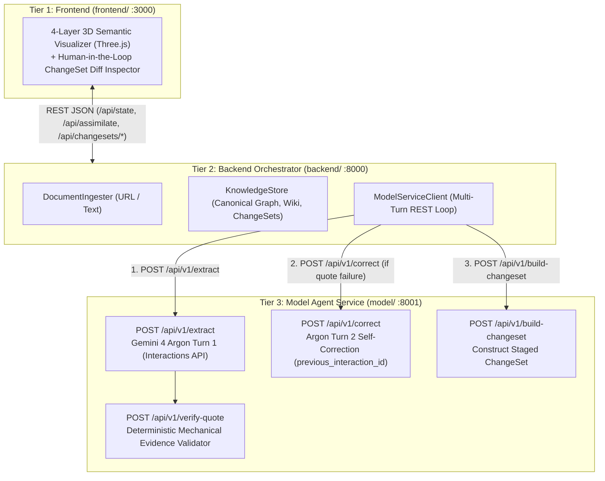

# Project IDEA — Autonomous Knowledge Assimilation Engine

[](https://project-idea-529324293576.asia-northeast3.run.app)
[](https://ai.google.dev)
[](https://ai.google.dev)
[](LICENSE)

> **Google DeepMind AI Hackathon Submission**  
> **Track 4: Open Innovation (Autonomous Agents and Developer Tools)**  
> **Live Web App**: [https://project-idea-529324293576.asia-northeast3.run.app](https://project-idea-529324293576.asia-northeast3.run.app)

---

## 💡 The Core Problem: Why Naive RAG & Auto-Synthesizers Fail

Current automated documentation and knowledge synthesis tools suffer from three fatal flaws when reading technical literature:
1. **Concept Fragmentation (Synonym Blindness)**: An agent reading about *"Tree search heuristics"* creates a brand new entity instead of aligning with existing canonical concepts like *"Monte Carlo Tree Search (MCTS)"*.
2. **Hallucinated Citations**: Models generate plausible-sounding claims and fabricate quotes or cite sections that do not exist in the source document.
3. **Silent Overwrite of Contradicting Facts**: When a new paper challenges an existing assumption, naive tools silently overwrite the wiki without human review or conflict detection.

---

## 🚀 The Solution: Project IDEA (3-Tier REST Architecture)

**Project IDEA** is an autonomous Knowledge Assimilation engine powered by **Gemini 4 Argon** and Google GenAI's **Interactions API**, structured into a decoupled **3-Tier REST API architecture** (`frontend/`, `backend/`, `model/`):



---

## 📂 3-Tier Folder Structure & REST API Contract

```text
project-idea/
├── frontend/                  # Tier 1: 3D Visualizer SPA & Frontend Server (:3000)
│   ├── index.html             # Glassmorphic UI, 3D Canvas & ChangeSet Review Drawer
│   ├── app.js                 # Three.js 4-plane renderer & configurable REST API client
│   └── server.py              # Standalone FastAPI server injecting window.BACKEND_API_URL
├── backend/                   # Tier 2: Stateful Knowledge Store & Orchestrator (:8000)
│   ├── schemas.py             # Backend Pydantic v2 models (ChangeSet, PipelineTrace, etc.)
│   ├── store.py               # In-memory Knowledge Graph, Living Wiki & ChangeSet state
│   ├── ingest.py              # Async URL HTML parser & raw text normalizer
│   ├── model_client.py        # httpx REST client driving the multi-turn Model Tier loop
│   ├── server.py              # Backend FastAPI endpoints (/api/state, /api/assimilate, etc.)
│   └── seed_domain.json       # Canonical AI/Search seed domain ontology
├── model/                     # Tier 3: Gemini 4 Argon Agent & Mechanical Validator (:8001)
│   ├── schemas.py             # Extraction & Model REST API schemas
│   ├── validator.py           # Deterministic verbatim quote & referential integrity validator
│   ├── agent_loop.py          # AssimilationEngine (Interactions API Turn 1 + Turn 2)
│   └── server.py              # Model Tier FastAPI server (/api/v1/extract, /correct, etc.)
├── scripts/
│   ├── eval_harness.py        # 3-scenario automated benchmark suite
│   └── verify_argon.py        # Gemini 4 Argon Interactions API smoke test
├── tests/                     # Unit & End-to-End 3-Tier REST Loop integration tests
└── start_3tier.sh             # Launches all 3 tiers locally (ports 3000, 8000, 8001)
```

### Tier-to-Tier REST Endpoints

| Tier | Endpoint | Method | Purpose |
| :--- | :--- | :---: | :--- |
| **Frontend (`:3000`)** | `/`, `/static/app.js`, `/health` | `GET` | Serves the 3D Semantic Visualizer SPA and injects `BACKEND_API_URL` |
| **Backend (`:8000`)** | `/api/state` | `GET` | Returns canonical concepts, relations, wiki claims, and pending ChangeSets |
| **Backend (`:8000`)** | `/api/assimilate` | `POST` | Ingests text/URL and orchestrates the multi-turn REST loop against Model Tier |
| **Backend (`:8000`)** | `/api/changesets/{id}/approve` | `POST` | Commits verified claims/concepts from a staged `ChangeSet` into the Living Wiki |
| **Backend (`:8000`)** | `/api/changesets/{id}/reject` | `POST` | Rejects a staged `ChangeSet` without mutating the Living Wiki |
| **Backend (`:8000`)** | `/api/reset` | `POST` | Resets KnowledgeStore back to canonical `seed_domain.json` |
| **Model (`:8001`)** | `/api/v1/verify-quote` | `POST` | Deterministic verbatim & normalized quote verification (`EvidenceValidator`) |
| **Model (`:8001`)** | `/api/v1/extract` | `POST` | Turn 1 Gemini 4 Argon extraction + mechanical quote failure detection |
| **Model (`:8001`)** | `/api/v1/correct` | `POST` | Turn 2 stateful self-correction via `previous_interaction_id` |
| **Model (`:8001`)** | `/api/v1/build-changeset` | `POST` | Converts validated extraction into a staged `ChangeSet` |
| **Model (`:8001`)** | `/api/v1/assimilate` | `POST` | Full 2-turn pipeline returning both `ChangeSet` and `PipelineTrace` |

---

## 🌟 Key Innovations & Technical Highlights

### 1. Two-Turn Self-Correction via Gemini 4 Argon Interactions API
- **State Preservation**: Uses `client.interactions.create` with `previous_interaction_id` to pass deterministic validation errors back to Argon in Turn 2.
- **Implicit Context Caching**: Benefits from automatic 95% prompt cache discounts across multi-turn verification loops.
- **Controlled Reasoning**: Configured with `thinking_level="medium"` and `thinking_summaries="auto"` to surface Argon's reasoning trace in the UI.

### 2. Deterministic Mechanical Evidence Validator
- Zero-trust architecture: LLM outputs are never trusted blindly.
- Every claim must cite a verbatim quote verified deterministically via strict normalized substring matching against raw document text.

### 3. Human-in-the-Loop Gate (No Silent Overwrite)
- Contradicting or ambiguous facts are strictly categorized as `UNRESOLVED`.
- Mutations are staged as Knowledge Diffs (`ChangeSet`) requiring explicit human approval before touching the Living Wiki.

### 4. 4-Layer 3D Semantic Visualizer (Three.js)
- Renders 4 interactive semantic planes:
  - **Living Wiki** (Blue): Human-facing synthesized claims.
  - **Knowledge Graph** (Green): Validated relational triples.
  - **Domain Ontology** (Purple): Canonical domain entities.
  - **Source Evidence** (Amber): Verbatim grounded text citations.
- Bidirectional provenance: Click any node to inspect its exact source evidence anchor.

---

## 📊 Automated Verification & Benchmark Suite

Run the unit and end-to-end 3-Tier REST integration test suite:
```bash
uv run pytest
```

Run the live Gemini 4 Argon evaluation suite (`eval_harness.py`):
```bash
PYTHONPATH=. uv run python scripts/eval_harness.py
```

| Benchmark Scenario | Mechanism Tested | Expected Result | Status |
| :--- | :--- | :--- | :---: |
| **1. Synonym Alignment** | Canonical Concept Matching | Maps `"tree search heuristic"` to `concept_mcts` (`MATCH`) | ✅ **PASSED** |
| **2. Quote Grounding** | Mechanical Substring Validator | Rejects hallucinated quotes; Argon self-corrects in Turn 2 | ✅ **PASSED** |
| **3. Contradiction Gate** | Silent Overwrite Prevention | Conflicting claims flagged as `UNRESOLVED` | ✅ **PASSED** |

---

## 🛠️ Local Development & Quickstart

```bash
# Clone the repository
git clone https://github.com/GoBeromsu/project-idea.git
cd project-idea

# Set environment variables
echo "GEMINI_API_KEY=your_key_here" > .env

# Install dependencies using uv
uv sync

# Launch all 3 tiers (Model :8001, Backend :8000, Frontend :3000)
./start_3tier.sh
```
Open [http://localhost:3000](http://localhost:3000) (Frontend Tier) or [http://localhost:8000](http://localhost:8000) (Backend single-port convenience endpoint) in your browser.

---

## 🚢 Continuous Deployment (Google Cloud Run)

In container environments, `Dockerfile` launches the Model Tier (`model.server:app`) on `127.0.0.1:8001` and serves the Backend + static Frontend (`backend.server:app`) on `0.0.0.0:${PORT:-8080}`:
```bash
./deploy.sh
```
