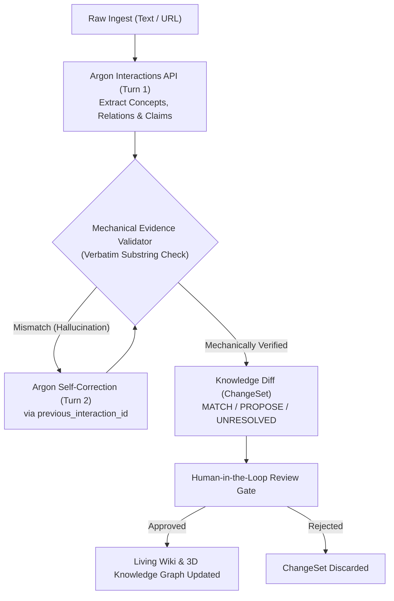

# Project IDEA — Autonomous Knowledge Assimilation Engine

[](https://project-idea-529324293576.asia-northeast3.run.app)
[](https://ai.google.dev)
[](https://ai.google.dev)
[](LICENSE)

> **Google DeepMind AI Hackathon Submission**  
> **Track 4: Open Innovation (Autonomous Agents and Developer Tools)**  
> **Live Web App**: [https://project-idea-529324293576.asia-northeast3.run.app](https://project-idea-529324293576.asia-northeast3.run.app)

---

## 💡 The Core Problem: Why Naive RAG & Auto-Synthesizers Fail

Current automated documentation and knowledge synthesis tools suffer from three fatal flaws when reading technical literature:
1. **Concept Fragmentation (Synonym Blindness)**: An agent reading about *"Tree search heuristics"* creates a brand new entity instead of aligning with existing canonical concepts like *"Monte Carlo Tree Search (MCTS)"*.
2. **Hallucinated Citations**: Models generate plausible-sounding claims and fabricate quotes or cite sections that do not exist in the source document.
3. **Silent Overwrite of Contradicting Facts**: When a new paper challenges an existing assumption, naive tools silently overwrite the wiki without human review or conflict detection.

---

## 🚀 The Solution: Project IDEA

**Project IDEA** is an autonomous Knowledge Assimilation engine powered by **Gemini 4 Argon** and Google GenAI's **Interactions API**. It introduces a verifiable, human-in-the-loop pipeline with 3D semantic visualization:



---

## 🌟 Key Innovations & Technical Highlights

### 1. Two-Turn Self-Correction via Gemini 4 Argon Interactions API
- **State Preservation**: Uses `client.interactions.create` with `previous_interaction_id` to pass deterministic validation errors back to Argon in Turn 2.
- **Implicit Context Caching**: Benefits from automatic 95% prompt cache discounts across multi-turn verification loops.
- **Controlled Reasoning**: Configured with `thinking_level="medium"` to ensure deep semantic conflict resolution within live interactive latency targets.

### 2. Deterministic Mechanical Evidence Validator
- Zero-trust architecture: LLM outputs are never trusted blindly.
- Every claim must cite a verbatim quote verified deterministically via strict normalized substring matching against raw document text.

### 3. Human-in-the-Loop Gate (No Silent Overwrite)
- Contradicting or ambiguous facts are strictly categorized as `UNRESOLVED`.
- Mutations are staged as Knowledge Diffs (`ChangeSet`) requiring explicit human approval before touching the Living Wiki.

### 4. 4-Layer 3D Semantic Visualizer (Three.js)
- Renders 4 interactive semantic planes:
  - **Living Wiki** (Blue): Human-facing synthesized claims.
  - **Knowledge Graph** (Green): Validated relational triples.
  - **Domain Ontology** (Purple): Canonical domain entities.
  - **Source Evidence** (Amber): Verbatim grounded text citations.
- Bidirectional provenance: Click any node to inspect its exact source evidence anchor.

---

## 📊 Benchmark Suite (`eval_harness.py`)

Run the automated evaluation suite:
```bash
PYTHONPATH=. uv run python scripts/eval_harness.py
```

| Benchmark Scenario | Mechanism Tested | Expected Result | Status |
| :--- | :--- | :--- | :---: |
| **1. Synonym Alignment** | Canonical Concept Matching | Maps `"tree search heuristic"` to `concept_mcts` (`MATCH`) | ✅ **PASSED** |
| **2. Quote Grounding** | Mechanical Substring Validator | Rejects hallucinated quotes; Argon self-corrects | ✅ **PASSED** |
| **3. Contradiction Gate** | Silent Overwrite Prevention | Conflicting claims flagged as `UNRESOLVED` | ✅ **PASSED** |

---

## 🛠️ Local Development & Quickstart

```bash
# Clone the repository
git clone https://github.com/GoBeromsu/project-idea.git
cd project-idea

# Set environment variables
echo "GEMINI_API_KEY=your_key_here" > .env

# Install dependencies using uv
uv sync

# Run the local development server
uv run uvicorn server:app --host 0.0.0.0 --port 8080 --reload
```
Open [http://localhost:8080](http://localhost:8080) in your browser.

---

## 🚢 Continuous Deployment (Google Cloud Run)

The service is containerized via multi-stage Docker build and deployed directly to Google Cloud Run:
```bash
./deploy.sh
```
